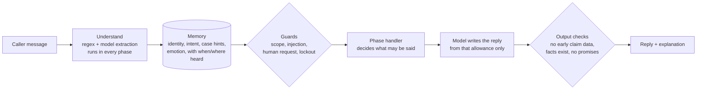

# Claims Support Agent

A support agent for insurance claims that follows a fixed SOP and still talks like a person.
The workflow is **VERIFY_ID → RESOLVE_INTENT → PROCESS_CASE → POST_PROCESS**.

**Live demo:** https://claims-sop-agent-dkzq.onrender.com
(free hosting, so the first visit after a quiet spell takes about a minute to wake up)

The idea in one line: **the SOP decides, the model interprets and speaks.** Phase order, the identity gate,
consent and what data the model may see are all enforced in code. The model reads messy language, writes the
replies, and reasons freely only where the SOP allows it.

## How it works



| Phase | Freedom | What controls it |
|---|---|---|
| VERIFY_ID | strict | A deterministic matcher. Any 3 of full name, DOB, phone, email, ID last-4 must match one record. The reply writer never receives claim data, so it cannot leak any. |
| RESOLVE_INTENT | guided | The model maps messy wording to a small set of intents. Code picks the claim from the caller's own claims and asks one question if it is ambiguous. |
| PROCESS_CASE | free, but grounded | The model answers using read-only tools scoped to the verified caller. A fact check rejects any claim ID, amount or date that is not in the tool results. |
| POST_PROCESS | strict consent | Asks whether to send an email summary. Send or skip is the caller's choice, and it only goes to the address on file. |

Anything said early is kept. "My denied healthcare claim from January", said during verification, is stored,
the agent stays in VERIFY_ID, and the claim is picked straight away once the caller is verified.

**Safeguards**
- No claim details, and no yes/no hints about on-file data, before verification. Wrong details never say which field failed.
- Three failed attempts hand the caller to a person.
- Prompt injection, fake system messages and "I'm an admin" change nothing, because the gates are not in the prompt.
- Replies cannot promise things the system cannot do (callbacks, refunds, payout dates).
- Out-of-scope questions get a polite decline, then a firmer one, then an offer of a human.
- Frustrated callers get acknowledgement first, the reason for the step, the allowed alternatives, and a warm
  handoff with notes if it is not working.
- A representative (David Chen) needs the policyholder's consent. If it times out, nothing is disclosed.

## Run it

```bash
docker compose up --build        # or: ./run.sh (macOS/Linux), run.bat (Windows)
```

Open http://localhost:8000.

**Model access.** Either copy `.env.example` to `.env` and fill in one provider, or click **Use your own API key**
in the app. Supported: **AWS Bedrock** (default), **Anthropic**, **OpenAI** and **Google Gemini**. Each provider
lists only the models that suit this app, and *Test connection* checks the three things it needs (plain replies,
structured output, tool calls) and how fast the model is. Keys stay in server memory and are never written to disk
or returned by the API.

## Try it

Open the app and click **Demo case**: the caller is verified in one message and the agent goes straight to
claim CL-2048, the denied one, not the closed January claim. Then ask follow-ups, say "that's all", and choose to
send or skip the email summary. The other cards cover a frustrated caller, an off-topic question and a caller
phoning for a parent. **Test identities** lists everyone in the fixtures.

## Tests

```bash
cd apps/insurance_claims/backend
python -m pytest tests/unit -q       # 43 tests, no model needed
python tests/run_scenarios.py        # 36 live conversations against the configured model
```

The live suite checks workflow state, not wording: 20 normal conversations and 16 adversarial ones (fishing for
data, fake system messages, another customer's claim, emailing a third party, sustained abuse and so on). Three
checks run on every reply: no claim data before verification, no reading back personal data, no promises the
system cannot keep. All 36 pass on Claude Haiku 4.5 (default, about 3 s a reply) and Sonnet 4.5 and 4.6.

Verified end to end: **AWS Bedrock with Claude** (the three models above). The OpenAI, Gemini and Anthropic-direct
adapters were checked against a local mock that copies each API's rules (parameters newer models reject, forced
tool calls), not against the live services, because no keys were available. If a model rejects something, the
adapter adjusts and retries, and *Test connection* tells you before you switch.

## Project layout

```
apps/insurance_claims/
  fixtures/   the starter data, unchanged
  backend/    FastAPI app: app/sop (workflow), app/nlu, app/data, app/llm (model adapters), tests
  frontend/   the chat UI, served by the backend
```

More: [design notes](docs/DESIGN.md) · [deploying](docs/DEPLOY.md) · settings in `.env.example`
(`DEMO_TODAY` defaults to 2026-03-05 so the fixture appeal deadlines are still open).
